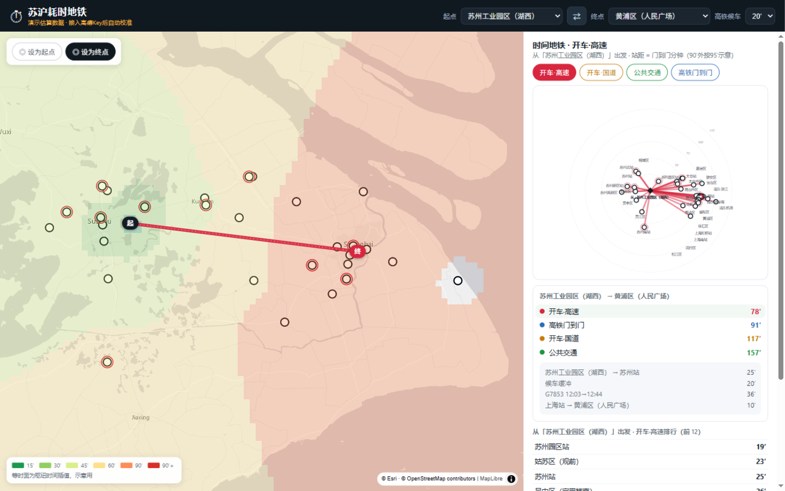
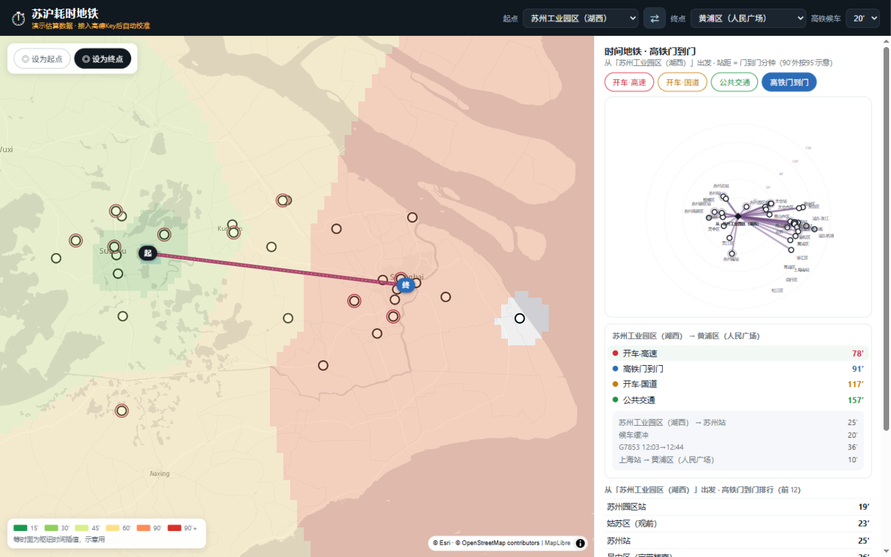

# 苏沪耗时地铁 · 双视图

一个覆盖苏州、上海两市的「点到点门到门耗时」可视化应用：以真实路网/公交逻辑为基础，
把任意起点到各枢纽的门到门分钟数画成**热力地图**（左）与**时间地铁径向图**（右）双视图，
支持驾车（高速 / 国道）、公共交通、高铁门到门四种模式，支持枢纽与地图自由点互选起终点。





## 快速开始

```bash
python -m uvicorn apps.api.main:app --port 8000
# 打开 http://127.0.0.1:8000/
```

依赖：Python 3.10+（fastapi、uvicorn）、前端库已本地化在 `apps/web/vendor/`（MapLibre、d3），
底图使用 Esri World Light Gray 免费瓦片（无需 Key）。

## 功能说明

- **热力地图（左）**：从起点出发的门到门等时圈，6 档配色
  （15/30/45/60/90/90+ 分钟，绿→黄→红，90′ 以上不填充），
  OD 路线用当前模式色高亮，起/终点用「起/终」图钉标识。
- **时间地铁（右）**：把「起点 → 各枢纽」的分钟数画成放射状地铁图——
  中心菱形为起点，站距 = 门到门分钟（半径刻度随模式最大分钟自适应），
  点击站点可将其设为终点；虚线外环 = 高铁站。
- **对比面板**：当前 OD 四种模式的分钟排行 + 高铁明细
  （接驳 → 候车缓冲 → 车次 → 落地接驳）。
- **排行表**：从当前起点出发的前 12 枢纽分钟排行，点击行直接设为终点。
- **自由点**：地图任意点选起/终点；自由点按「就近枢纽接驳」模型计价
  （接驳段 = 直线距离 × 绕行系数 ÷ 分段车速，两端接驳 + 枢纽间矩阵段）。
- **候车缓冲**：右上角可选（默认 20′），作用于高铁与公交的换乘等待。

## 数据与模型（source 标注）

| 数据 | 文件 | 当前来源 |
|---|---|---|
| 枢纽 | `data/hubs.geojson`、`data/hubs.csv` | 31 个枢纽（苏州 16 + 上海 15），人工整理 |
| 驾车·高速 / 国道 | `data/matrix/driving.json`、`driving_local.json` | `estimate`（分段车速模型 + 经验锚点手工校准） |
| 公共交通 | `data/matrix/transit.json` | `estimate`（步行+轨道+接驳模型） |
| 高铁 | `data/hsr.json` | `synthetic`（按线路密度合成时刻表，**非真实车次**） |

自由点接驳估算模型见 `scripts/estimate_model.py`；各矩阵的来源标注写入文件 `meta.source`，
前端徽章据此显示「演示估算数据」或「已接入高德实测数据」。

## 脚本

```bash
python scripts/build_hubs.py           # 重建枢纽 geojson/csv
python scripts/build_matrix_estimate.py # 重建估算矩阵（driving/driving_local/transit）
python scripts/build_hsr.py            # 重建合成高铁时刻表（双向）
python scripts/build_matrix_amap.py    # 【需 AMAP_KEY】用高德重算矩阵并覆盖 estimate
```

## 接入高德实测数据（可选校准）

1. 到高德开放平台申请 **Web 服务** Key（需开通驾车路径规划、公交路径规划）。
2. 设置环境变量后重建矩阵：

```bash
set AMAP_KEY=你的key
python scripts/build_matrix_amap.py
```

3. 重启服务，徽章会自动切换为「已接入高德实测数据」。

## 已知边界（诚实声明）

- **高铁时刻表为合成数据**：车次号、发到时间不可作为出行参考，只用于演示
  「时刻表驱动的门到门计算」这一机制；接入真实时刻表后 `data/hsr.json` 可直接替换。
- **公交/驾车分钟为估算**：未接入高德前是模型推算，高峰/平峰差异未建模。
- **矩阵为 31×31 枢纽 OD**：自由点不进矩阵，走就近枢纽接驳（两端接驳段用估算模型）。
- 换乘等待统一用「候车缓冲」参数近似，未做逐线路班次密度建模。

## 目录结构

```
apps/api/main.py        FastAPI 后端：/api/times、/api/isochrone、/api/route、静态托管
apps/web/               前端（index.html + js/core|main|metro.js + vendor 本地库）
data/                   hubs + matrix/*.json + hsr.json
scripts/                数据构建脚本（见上）
.tmp/shots/             验收截图（judge 视觉验收用，非运行时依赖）
```
